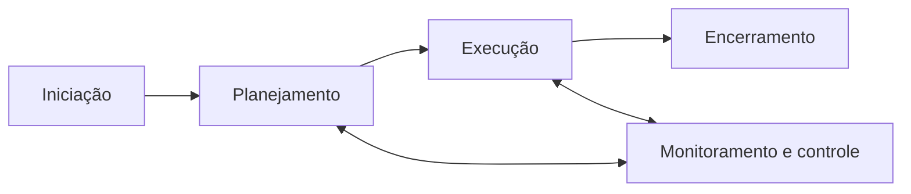
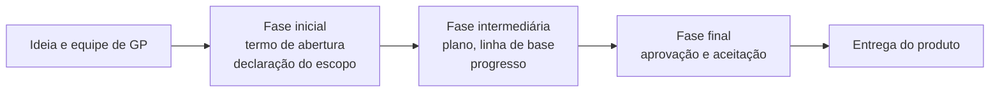
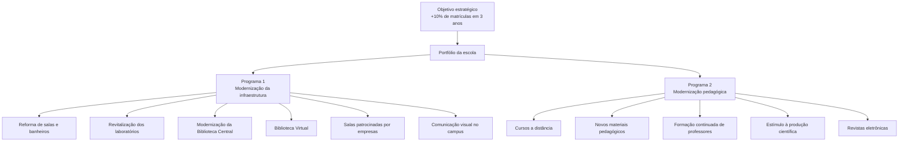

# Resumo da Aula 01 — Apresentação da Disciplina e Contextualização

| Campo | Informação |
|---|---|
| **Disciplina** | Gestão de Projetos — Análise e Desenvolvimento de Sistemas (UniSENAI-SP, Campus Sorocaba) |
| **Professor** | Prof. Me. Deivison S. Takatu |
| **Aluno** | Felipe Marques (grupo do projeto FieldOps) |
| **Fontes** | Slides da Aula 01, Plano de Ensino, material de apoio "01 - Introdução" e Scrum Guide (2020) |
| **Data** | 18/11/2026 |
| **Versão** | 1.0 |

---

## 1. O que a Aula 01 apresenta

A primeira aula faz duas coisas: explica como a disciplina funciona (plano de ensino, metodologia, avaliação, primeira atividade) e apresenta o vocabulário de base de gestão de projetos, que as aulas seguintes vão aprofundar (processos, escopo, tempo, custos, qualidade, recursos, comunicações, riscos, aquisições e partes interessadas).

O argumento do professor para estudar o assunto cabe em cinco linhas: empresas trabalham por projetos, projetos reduzem desperdício, melhoram a qualidade, aumentam a produtividade e aparecem em todas as áreas. A aula também contextualiza a disciplina no curso: aplicações web modernas usam frameworks front-end, e empresas precisam de interfaces rápidas, organizadas e fáceis de manter. Isso aparece como requisito estratégico para a competitividade e como questão de arquitetura de software (como as partes se ligam).

### Plano de ensino em uma tabela

| Item | O que diz o plano |
|---|---|
| Carga | 80 horas-aula de 50 min (66h40 em hora-relógio) |
| Objetivo | Desenvolver capacidades técnicas e socioemocionais para coordenar projetos de integração de sistemas em ambientes de produção industrial |
| Conteúdos | 1. Gerenciamento de projetos (áreas, processos, restrição tripla, normas e legislação contratual); 2. Planejamento (escopo, entregas, esforços, custos, tempo, recursos, riscos, ferramentas); 3. Controle (implementação dos planos, controle de alterações, monitoramento, finalização); 4. Ferramentas ágeis (Scrum, Kanban, XP, FDD, MSF/DSDM) |
| Capacidades técnicas | Usar metodologias ágeis; definir a estrutura de gestão; otimizar recursos; aplicar normas e legislação contratual; usar software de gerenciamento; controlar a qualidade da execução; avaliar riscos |
| Capacidades socioemocionais | Aprendizagem ativa, criatividade e iniciativa, ética, resolução de problemas complexos |

---

## 2. O que é um projeto

Pelos slides, citando o PMI (2004), projeto é um esforço progressivo e temporário para criar um produto ou serviço único. "Progressivo" quer dizer que ele evolui aos poucos, passando por etapas. O material de apoio usa a definição mais recente: esforço temporário para criar um produto, serviço ou resultado único.

Duas características definem o conceito:

- **Temporário:** tem início e fim definidos. Pode durar semanas ou anos, mas o encerramento é previsto.
- **Único:** gera um resultado específico, que não é a repetição de algo já feito.

Um projeto também tem objetivo (o que se quer alcançar) e recursos limitados: pessoas, dinheiro e tempo. Exemplos da aula: construir uma casa, desenvolver um aplicativo, organizar um evento, implantar um sistema, criar um site, modernizar um laboratório.

Na prática, todo projeto responde a seis perguntas:

| Elemento | Pergunta |
|---|---|
| Objetivo | O que queremos alcançar? |
| Entregas | O que será produzido? |
| Pessoas | Quem realizará o trabalho? |
| Prazo | Quando deve terminar? |
| Recursos | Quanto será necessário? |
| Riscos | O que pode dar errado? |

### Projeto × operação

Projeto muda alguma coisa e acaba; operação mantém a organização funcionando e não tem data de término. Os dois se encontram quando o resultado do projeto entra em operação.

| Projetos | Operações |
|---|---|
| Temporários, com início e fim | Contínuas, sem encerramento previsto |
| Produzem resultado único | Produzem atividades recorrentes |
| Criam mudança | Mantêm o funcionamento |

Exemplo do material: desenvolver uma plataforma de vendas é projeto; usá-la todo dia para atender clientes é operação.

### Entrega × valor de negócio

A entrega é o que o projeto produz; o valor são os benefícios que essa entrega gera (um aplicativo funcional é entrega, o aumento de vendas é valor). Um projeto não deve ser avaliado só por ter entregado, e sim pelo benefício para a organização e para as partes interessadas.

---

## 3. Gerenciamento de projetos e o PMBOK

**Gerenciar um projeto** é aplicar conhecimentos, habilidades, ferramentas e técnicas às atividades do projeto para atender aos requisitos. Na prática: planejar, executar, monitorar, controlar, entregar e encerrar formalmente.

O **PMBOK** (*Project Management Body of Knowledge*) é o guia do PMI (*Project Management Institute*) que organiza essas práticas. Na versão usada em aula ele se divide em:

- **47 processos**, e
- **10 áreas de conhecimento**.

### As 10 áreas e seus 47 processos

A numeração segue a figura dos slides (capítulos 4 a 13 do guia).

| Cap. | Área de conhecimento | Processos | Qtd. |
|---|---|---|---:|
| 4 | Integração | Desenvolver o termo de abertura; desenvolver o plano de gerenciamento; orientar e gerenciar a execução; monitorar e controlar o trabalho; controle integrado de mudanças; encerrar o projeto ou fase | 6 |
| 5 | Escopo | Planejar o escopo; coletar requisitos; definir o escopo; criar a EAP; validar o escopo; controlar o escopo | 6 |
| 6 | Tempo | Planejar o cronograma; definir, sequenciar, estimar recursos e estimar durações das atividades; desenvolver e controlar o cronograma | 7 |
| 7 | Custos | Planejar custos; estimar custos; determinar o orçamento; controlar custos | 4 |
| 8 | Qualidade | Planejar a qualidade; realizar a garantia da qualidade; controlar a qualidade | 3 |
| 9 | Recursos humanos | Planejar RH; mobilizar a equipe; desenvolver a equipe; gerenciar a equipe | 4 |
| 10 | Comunicações | Planejar as comunicações; gerenciar as comunicações; controlar as comunicações | 3 |
| 11 | Riscos | Planejar; identificar; análise qualitativa; análise quantitativa; planejar respostas; controlar riscos | 6 |
| 12 | Aquisições | Planejar; conduzir; controlar; encerrar aquisições | 4 |
| 13 | Partes interessadas | Identificar; planejar o gerenciamento; gerenciar o engajamento; controlar o engajamento | 4 |
| | **Total** | | **47** |

A figura do PMBOK nos slides coloca **escopo, tempo e custos** como o triângulo central (a restrição tripla do plano de ensino), com a qualidade ao redor dele, e mostra integração, comunicações e riscos como o anel externo. Recursos humanos e aquisições entram como suporte. O recado é que as áreas se afetam: aumentar o escopo mexe em prazo, custo, recursos e riscos, e por isso a gestão precisa ser integrada.

| Mudança | Possível efeito em cadeia |
|---|---|
| Novo requisito | Escopo maior |
| Escopo maior | Mais trabalho |
| Mais trabalho | Duração maior |
| Duração maior | Custo maior |
| Mais recursos | Novos riscos e novas necessidades |

> **Observação de estudo:** o slide mostra a capa do PMBOK 6ª edição, mas os nomes das áreas (Tempo, Recursos Humanos, Partes Interessadas) e a conta de 47 processos são os da 5ª edição. A 6ª edição renomeou áreas (Cronograma, Recursos) e passou a ter 49 processos. Para a disciplina vale a contagem da aula (47).

### Grupos de processos

Além das áreas, os processos são organizados em cinco grupos (detalhados na Aula 03): iniciação, planejamento, execução, monitoramento e controle, e encerramento. As áreas dizem **o que** gerenciar; os grupos dizem **quando** e **para quê**. Esses grupos não são fases do projeto.

---

## 4. Ciclo de vida do projeto

O slide "Ciclo de Vida de um Projeto" (fonte: PMBOK) divide o projeto em três fases genéricas, cada uma com entradas e saídas:

| Fase | Saídas típicas |
|---|---|
| Inicial | Termo de abertura e declaração do escopo (a partir da ideia e da equipe de gerenciamento) |
| Intermediária | Plano, linha de base e progresso |
| Final | Aprovação, aceitação e a entrega do produto |

Em paralelo, os grupos de processos se encadeiam assim: **iniciação → planejamento → execução → encerramento**, com **monitoramento e controle** ligado ao planejamento e à execução durante todo o tempo, porque o que é executado volta para o plano quando há desvio.

---

## 5. Habilidades do gerente de projetos

O gerente integra pessoas, processos e recursos. O slide lista onze habilidades:

| Habilidade | Para que serve no dia a dia do projeto |
|---|---|
| Liderança | Conduzir a equipe para o objetivo |
| Influência | Conseguir apoio sem depender de autoridade formal |
| Ganho de confiança | Ser acreditado por equipe e partes interessadas |
| Construção de equipes | Fazer pessoas diferentes trabalharem juntas |
| Tomada de decisões | Escolher entre alternativas com os dados disponíveis |
| Gestão de conflitos | Tratar divergências antes que travem o trabalho |
| Motivação | Manter o engajamento ao longo do projeto |
| Consciência cultural | Respeitar diferenças de perfil, área e organização |
| Coaching | Desenvolver as pessoas do time |
| Comunicação | Passar a informação certa, no momento certo, ao público certo |
| Negociação | Conciliar interesses de partes interessadas diferentes |

O material de apoio acrescenta que o gerente precisa de **competência técnica** (planejar, analisar riscos, acompanhar prazos e custos, tratar mudanças) e de **habilidades interpessoais** (escuta ativa, empatia, resolução de conflitos). Exemplo dado: dois integrantes discordam sobre uma solução. O gerente ouve as partes, entende o problema, levanta alternativas, avalia impactos, decide e comunica a decisão à equipe.

---

## 6. Projetos, programas e portfólios

| Estrutura | Definição | Característica |
|---|---|---|
| **Projeto** | Esforço temporário para um resultado único | Produz uma entrega específica |
| **Programa** | Grupo de projetos relacionados, gerenciados de forma coordenada | Obtém benefícios que o gerenciamento individual não obteria |
| **Portfólio** | Coleção de projetos e programas agrupados para facilitar a gestão e apoiar a estratégia | Seleciona e prioriza iniciativas |

Em uma frase: projeto entrega um resultado, programa coordena projetos, portfólio organiza iniciativas de forma estratégica. Gerenciar portfólio inclui decidir o que **não** fazer: se a empresa tem dez propostas e recursos para quatro, ela compara benefício, custo, risco, recursos e alinhamento estratégico, prioriza e seleciona, e depois acompanha os resultados.

### Estratégia organizacional: o exemplo da escola

O slide parte de um objetivo: **uma escola quer aumentar em 10% o número de matrículas nos próximos 3 anos**. Para isso escolheu duas estratégias, modernização e divulgação intensa na mídia, e criou programas que contêm projetos:

São 2 programas e 11 projetos (6 + 5). Cada projeto tem entregas próprias, mas só faz sentido dentro da visão maior: o objetivo estratégico. A cadeia completa é **estratégia → objetivos → portfólio → programas → projetos → benefícios → valor**.

Outro exemplo do material: uma instituição que quer fazer transformação digital cria um portfólio de tecnologia, com o programa de transformação digital, que reúne os projetos de novo aplicativo, novo sistema e automação de processos.

### PMO

O Escritório de Gerenciamento de Projetos (PMO) é uma estrutura que apoia projetos, programas e portfólios. As funções variam, mas costumam incluir padronizar metodologia, oferecer modelos de documentos (como o modelo de TAP usado na Aula 02), consolidar informação, acompanhar indicadores (prazo, custo, progresso), apoiar a governança e compartilhar boas práticas e lições aprendidas.

### Fatores organizacionais

Estrutura, cultura, processos, comunicação, pessoas, recursos, liderança e políticas influenciam o projeto. Uma organização com boa comunicação, processos definidos e apoio da liderança dá melhores condições para o projeto andar.

---

## 7. Metodologias ágeis

A aula só abre o assunto (o tema volta no conteúdo 4 do plano de ensino, "Ferramentas ágeis"). O slide mostra um quadro **Kanban** (colunas Tasks, To Do, In Progress, Testing, Complete) e uma nuvem de termos: Agile, Scrum, XP, sprints, backlog, retrospective, risks, teamwork.

O que dá para fixar desde já:

- **Abordagem iterativa e incremental:** o produto é entregue em ciclos curtos, cada um deixando algo funcionando e revisável, em vez de uma entrega única no fim.
- **Kanban:** quadro visual com colunas de fluxo de trabalho; o limite de itens em andamento evita sobrecarga.
- **Scrum** (Scrum Guide 2020): times com Product Owner, Scrum Master e Developers; sprint de até um mês com cinco eventos (a própria sprint, planejamento, reunião diária, revisão e retrospectiva) e três artefatos (Product Backlog, Sprint Backlog e Incremento).
- **XP, FDD, MSF e DSDM:** outras abordagens que o plano de ensino lista para as aulas de ferramentas ágeis.

Ágil e PMBOK não competem: o PMBOK diz o que precisa ser gerenciado, e a abordagem ágil define como o trabalho é entregue em ciclos.

---

## 8. Metodologia de ensino: PBL

A disciplina usa **aprendizagem baseada em projetos (PBL)**, uma metodologia ativa em que os estudantes desenvolvem soluções práticas ou resultados concretos. O trabalho é feito normalmente em grupo e busca desenvolver a capacidade criativa para lidar com problemas difíceis ou mal estruturados. Aqui isso significa que o planejamento não é só estudado: é aplicado a um projeto real do grupo (o FieldOps).

---

## 9. Critérios de avaliação

| Componente | Peso | Detalhe |
|---|---:|---|
| **Avaliação docente** | **55%** | |
| — Desenvolvimento de Projeto | 20% | Documentação completa do projeto, como um "mini TCC": da concepção à entrega final, com planejamento, execução, resultados, desafios, soluções adotadas e análise crítica |
| — Apresentação do Projeto | 20% | Foco no processo de gestão: organização do backlog, páginas desenvolvidas e análise de benchmarking com soluções do mercado |
| — Realização das atividades | 15% | Atividades semanais em grupo |
| **Projeto Integrador** | **35%** | |
| **Autoavaliação** | **10%** | |
| **Total** | **100%** | |

Conferência: 20 + 20 + 15 = 55; 55 + 35 + 10 = 100.

---

## 10. Atividade da Aula 01

1. Formar grupos de 3 a 5 integrantes. As atividades semanais são feitas e entregues em grupo, sempre com a mesma composição.
2. Criar um repositório no GitHub, que será o diretório principal das atividades do semestre.
3. Nesse repositório, criar um arquivo Markdown (`.md`) com o resumo da Aula 01, cobrindo os principais conceitos (este documento).

Nosso grupo tem 5 integrantes (Felipe Marques, Gabriel Ribeiro, Pedro Dias, André Fernandes e João Victor Souza), dentro do limite de 3 a 5.

---

## 11. Conexão com o FieldOps

O FieldOps é o projeto que o grupo planeja ao longo da disciplina, e a Aula 01 aparece nele de forma concreta:

| Conceito da aula | Como aparece no FieldOps |
|---|---|
| Projeto (temporário e único) | MVP de uma plataforma de inspeção em campo, com início em 10/08/2026 e término previsto em 27/11/2026 (16 semanas); resultado único: app Android, painel web e API integrados |
| Restrição tripla | Prazo fixo (16 semanas), escopo fechado no MVP e custo sem investimento financeiro direto; a "ordem de corte" do escopo é a válvula quando o prazo aperta |
| Entrega × valor | A entrega é o MVP rodando ponta a ponta; o valor está em reduzir retrabalho e perda de dados de inspeção e em dar rastreabilidade ao resultado |
| Ciclo de vida e grupos de processos | O TAP é a saída da iniciação; a EAP, o cronograma e os planos são planejamento; as 8 sprints são execução; os marcos M1 a M8 e o status de 18/11 são monitoramento e controle; o encerramento é o aceite, as lições aprendidas e o relatório final |
| Habilidades do gerente | O gerente (Felipe Marques) também desenvolve o app mobile: acumula gestão e desenvolvimento, e isso é tratado como risco de sobrecarga e de dependência de uma pessoa |
| Portfólio, programa e projeto | O FieldOps é um projeto dentro do programa de integração das disciplinas de mobile, backend e web; o cenário MetalTech do desafio da disciplina é o exercício de portfólio |
| Ágil | O backlog tem 72 PBIs P0 em 10 épicos, executados em 8 sprints de 2 semanas, com quadro por milestone no GitHub e demonstração a cada marco |
| PMBOK e áreas | Cada atividade da disciplina corresponde a uma área: TAP (integração), EAP (escopo), cronograma (tempo), orçamento (custos), 7 ferramentas (qualidade), RACI e plano de comunicação (RH e comunicações), análise de riscos, aquisições e partes interessadas |
| PBL | O planejamento é aplicado a um projeto real, com repositórios e issues, e não a um caso de papel |
| Avaliação | O projeto da disciplina tem duas avaliações de 5,0 pontos cada; a documentação do planejamento é o "mini TCC" do critério Desenvolvimento de Projeto (20%) e a apresentação final cobre o processo de gestão e o backlog (20%) |

Um dado que ilustra por que gerenciar importa: em 18/11/2026 o GitHub mostra 57 de 103 issues concluídas (cerca de 55%), com as sprints 6 e 7 atrasadas. É a situação que a Aula 01 descreve como monitoramento e controle: medir o desvio e aplicar a ordem de corte, em vez de esperar o fim do prazo.

---

## 12. Para lembrar

- Projeto transforma objetivo em resultado; é temporário e único.
- Programa coordena projetos relacionados; portfólio organiza iniciativas conforme a estratégia.
- O PMBOK (versão da aula) tem 10 áreas e 47 processos, e as áreas se influenciam.
- O gerente de projetos integra pessoas, processos e recursos; técnica sozinha não basta.
- O sucesso está na entrega **e** no valor gerado.

## Referências

- Slides da Aula 01, *Apresentação da Disciplina e Contextualização*. Prof. Me. Deivison S. Takatu.
- Plano de Ensino — Gestão de Projetos (UniSENAI-SP).
- Material de apoio "01 - Introdução" do repositório da disciplina.
- PMI. *Um Guia do Conhecimento em Gerenciamento de Projetos (Guia PMBOK)*.
- SCHWABER, K.; SUTHERLAND, J. *Guia do Scrum*, 2020 (versão em português).
- CARVALHO, Fábio Câmara Araújo de. *Gestão de projetos*. 2. ed. São Paulo: Pearson, 2018.
- CRUZ, Fábio. *Scrum e Agile em projetos*. 2. ed. Rio de Janeiro: Brasport, 2018.
- SUTHERLAND, Jeffrey Victor. *Scrum: a arte de fazer o dobro do trabalho na metade do tempo*. 2. ed. São Paulo: Leya, 2016.
