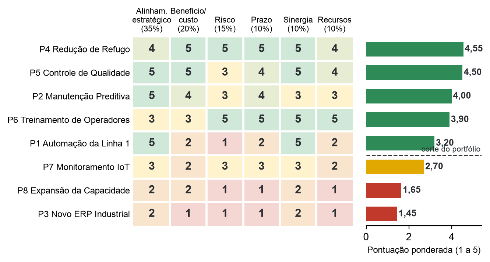
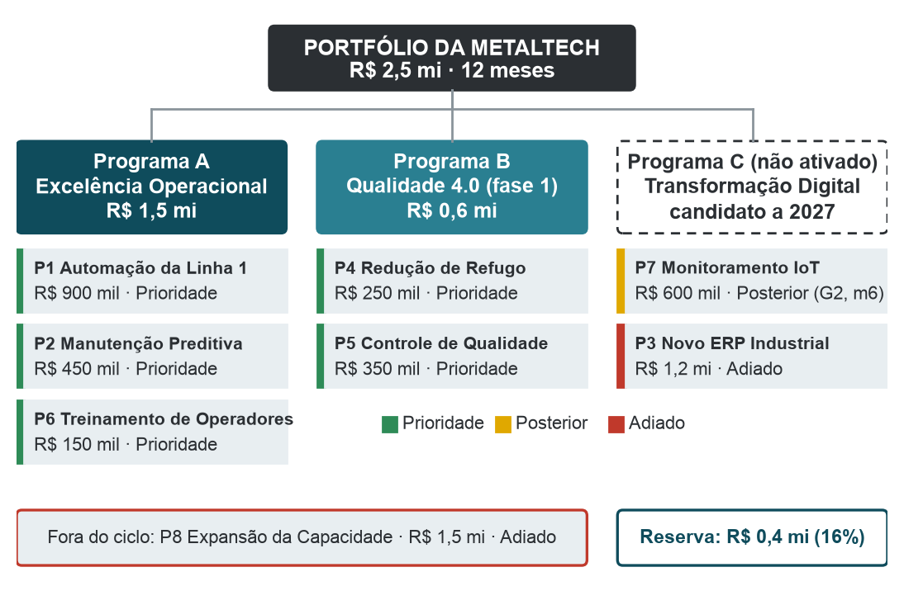
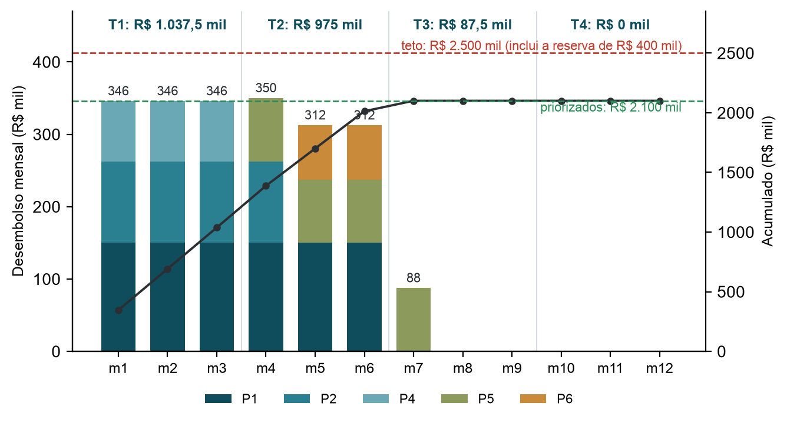
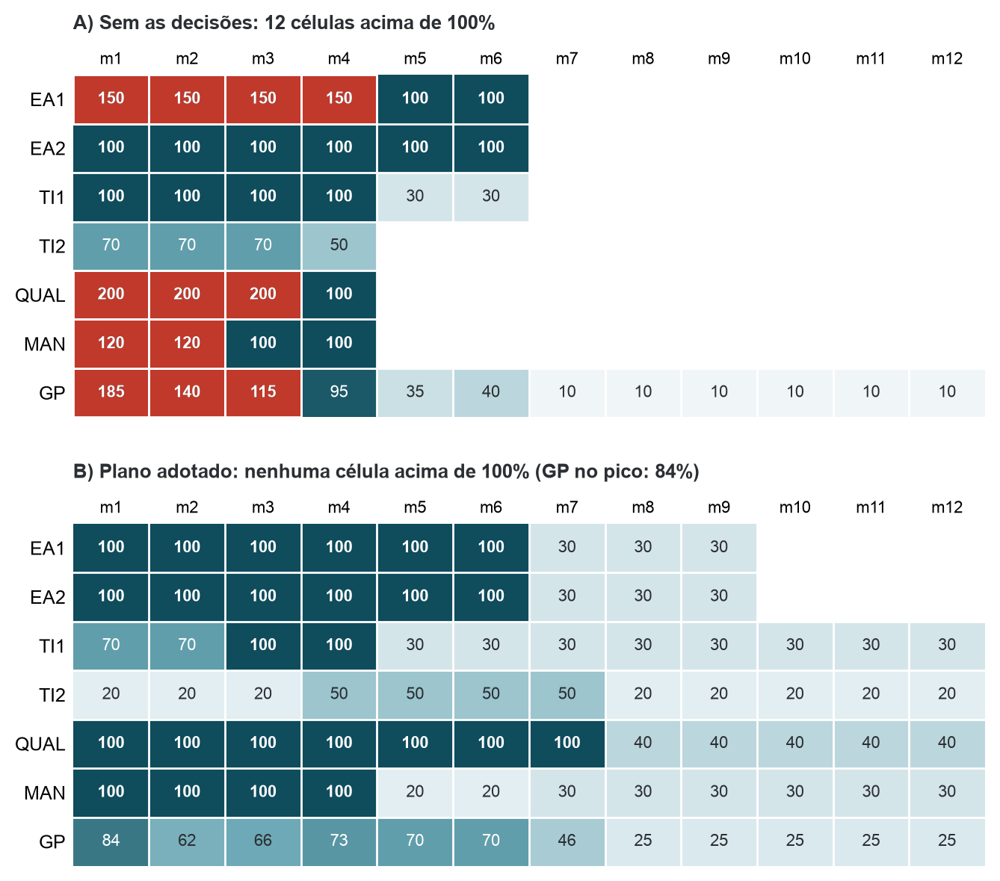
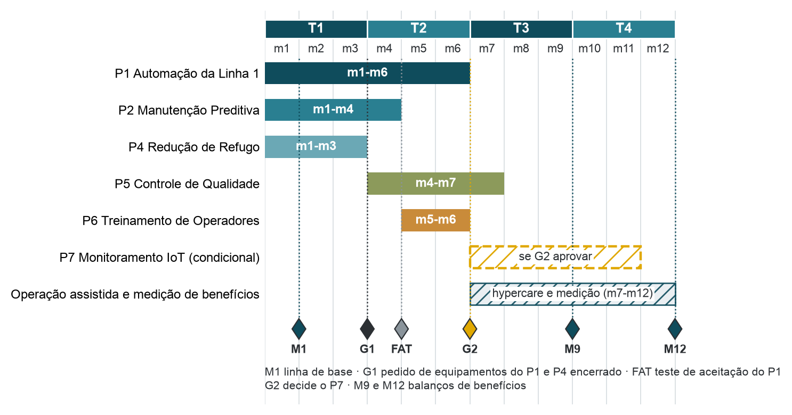
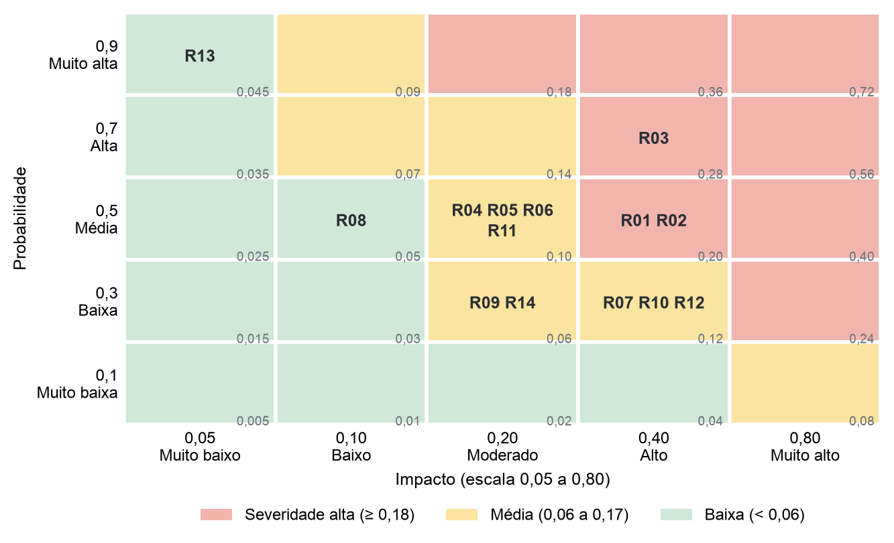
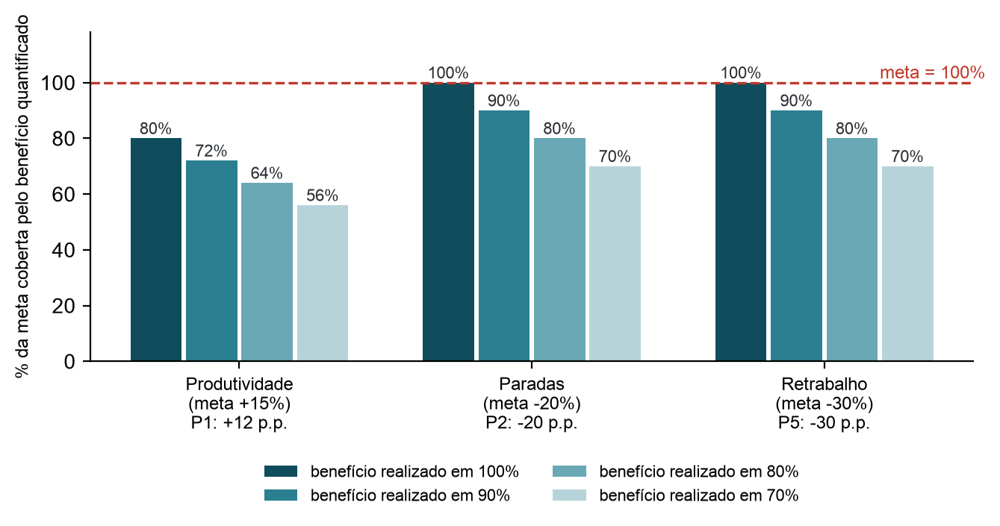

# Análise de Portfólio e Programas — MetalTech S.A.

| Campo | Conteúdo |
|:---|:---|
| Atividade | Desafio de Gestão de Portfólio e Programas (Gestão de Projetos, Prof. Me. Deivison Takatu, UniSENAI-SP Campus Sorocaba, ADS) |
| Papel do grupo | PMO (Project Management Office) da MetalTech S.A. |
| Grupo | Felipe Marques, Gabriel Ribeiro, Pedro Dias, André Fernandes, João Victor Souza |
| Data / versão | 18/11/2026 · v1.0 |
| Pergunta central | Como a empresa deve organizar seu portfólio de projetos para alcançar seus objetivos estratégicos utilizando os recursos disponíveis? |
| Entregas relacionadas | `slide-executivo.pptx` (+ `.png`, `.pdf`) · `roteiro-apresentacao-3min.md` · `relatorio-final-metaltech.docx` · `scripts/` (todas as contas) |

**Como ler os números.** Todo valor sai de `scripts/modelo_portfolio.py`. Neste documento, **DADO** é o que consta do enunciado do desafio; **(H)** marca hipótese ou premissa do grupo, a validar com a MetalTech. Valores em R$ mil, salvo indicação. T1 = meses 1 a 3, T2 = 4 a 6, T3 = 7 a 9, T4 = 10 a 12.

## Resposta em uma frase

Priorizar **P1, P2, P4, P5 e P6** (R$ 2,1 mi, 84% do teto), organizados nos programas **A (Excelência Operacional)** e **B (Qualidade 4.0, fase 1)**, manter **R$ 400 mil (16%) de reserva gerencial**, deixar o **P7 como posterior** (gate G2 no fim do m6) e **adiar P3 e P8**. É a única combinação dentro do teto que cobre as quatro metas com algum benefício quantificado e ainda deixa reserva para o projeto de risco alto.

## 1. Objetivos estratégicos e restrições (DADO)

| Objetivo | Meta | Leitura do PMO |
|:---|:---:|:---|
| Aumentar a produtividade | +15% | Só o P1 declara ganho numérico (+12%) |
| Reduzir paradas de produção | -20% | Só o P2 declara ganho numérico (-20%) |
| Reduzir custos operacionais | -10% | Nenhum projeto declara ganho em custo; o P4 reduz desperdício em 25% |
| Melhorar a qualidade | -30% de retrabalho | Só o P5 declara ganho numérico (-30%) |

**Restrições (DADO):** orçamento máximo de R$ 2,5 mi; 2 engenheiros de automação, 2 analistas de TI, 1 especialista em qualidade, 1 gerente de projetos e 1 especialista em manutenção; carteira total de R$ 5,4 mi em 8 projetos, ou seja, 2,16 vezes o orçamento.

## 2. Etapa 1 — Análise dos oito projetos

### 2.1 Dados do enunciado e indicadores derivados

| ID | Projeto | Investimento | % do teto | Prazo | Risco | Principal benefício (DADO) | Custo por p.p. (derivado) | Cobertura da meta (derivado) |
|:---|:---|---:|---:|---:|:---|:---|---:|:---|
| **P1** | Automação da Linha 1 | R$ 900 mil | 36,0% | 6 m | Alto | +12% produtividade | 75,0 mil/p.p. | 12 de 15 p.p. (80%) |
| **P2** | Manutenção Preditiva | R$ 450 mil | 18,0% | 4 m | Médio | -20% paradas | 22,5 mil/p.p. | 20 de 20 p.p. (100%) |
| **P3** | Novo ERP Industrial | R$ 1,2 mi | 48,0% | 10 m | Alto | Integração dos processos | n/d | sem número |
| **P4** | Redução de Refugo | R$ 250 mil | 10,0% | 3 m | Baixo | -25% desperdício | 10,0 mil/p.p. | desperdício, não custo: efeito sobre a meta de custos não convertido |
| **P5** | Controle de Qualidade | R$ 350 mil | 14,0% | 4 m | Médio | -30% retrabalho | 11,7 mil/p.p. | 30 de 30 p.p. (100%) |
| **P6** | Treinamento de Operadores | R$ 150 mil | 6,0% | 2 m | Baixo | Aumento de produtividade | n/d | sem número |
| **P7** | Monitoramento IoT | R$ 600 mil | 24,0% | 5 m | Médio | Dados em tempo real | n/d | sem número |
| **P8** | Expansão da Capacidade | R$ 1,5 mi | 60,0% | 12 m | Alto | +20% capacidade | 75,0 mil/p.p. | fora das 4 metas |

*Derivados:* custo por ponto percentual = investimento ÷ benefício declarado; só existe para os projetos com benefício numérico. O P4 reduz desperdício, não custo; o P8 aumenta capacidade, que não é um dos quatro objetivos; P3, P6 e P7 não têm benefício quantificado no enunciado. O ROI financeiro **não pode ser calculado** com os dados do enunciado (não há valor monetário de benefício); por isso o grupo usa custo por p.p. e cobertura de meta.

### 2.2 Relações, recursos e leitura de cada projeto

| Projeto | Dependências (DADO) | Recursos exigidos (H) | Leitura do PMO |
|:---|:---|:---|:---|
| P1 | Relaciona-se ao P6; recomendado antes do P8 | EA1 e EA2 a 100% por 6 meses; TI1 a 30% no m3-m6 | Meta de produtividade e adoção dependem do P6; é o maior risco do ciclo |
| P2 | Complementar ao P7 (dados) | MAN a 100% e TI1 a 70% por 4 meses; EA só consultivo | Entrega sozinho a meta de paradas, sem folga |
| P3 | Depende do P7 na etapa de integração | TI por 10 meses; integrador externo | Alto risco e benefício indireto; só faz sentido depois do P7 |
| P4 | Complementar ao P5 | QUAL a 100% no m1-m3; TI2 a 20% | Vitória rápida de baixo risco; alimenta o P5 |
| P5 | Complementar ao P4 | QUAL a 100% no m4-m7; TI2 a 50% | Entrega sozinho a meta de retrabalho, sem folga |
| P6 | Prepara os operadores para o P1 | MAN a 20% no m5-m6; conteúdo do fornecedor do P1 | Barato e de baixo risco; protege o investimento do P1 |
| P7 | Facilita a integração do P3 | EA e TI, ocupados pelo P1 até o m6 | Habilitador útil, mas não cabe com reserva no ciclo; decide-se no G2 |
| P8 | Executar o P1 antes ou junto | EA e TI o ano todo | Consumiria 60% do teto e 12 meses, com risco alto e sem meta direta |

## 3. Matriz de priorização ponderada

Pesos (definidos pelo grupo, **H**), notas de 1 a 5 (5 = melhor) e rubrica. As notas de **risco, prazo e benefício/custo** seguem regra objetiva sobre dados do enunciado e o script confere se a tabela bate com a regra (`assert` em `modelo_portfolio.py`). As demais (alinhamento, sinergia, recursos) são julgamento do grupo, justificado na tabela 3.3.

### 3.1 Critérios, pesos e rubrica

| Critério (peso) | Rubrica das notas |
|:---|:---|
| Alinhamento estratégico (35%) | 5 = fonte principal quantificada de uma das 4 metas (80% ou mais); 4 = benefício quantificado com efeito indireto sobre uma meta; 3 = ligado a uma meta, sem quantificação; 2 = benefício indireto ou fora das 4 metas; 1 = sem relação |
| Benefício/custo (20%) | Com benefício quantificado: custo por p.p. de até R$ 15 mil = 5; até 30 = 4; até 60 = 3; até 100 = 2; acima = 1. Sem benefício quantificado: investimento até R$ 150 mil = 3; até R$ 600 mil = 2; acima = 1 |
| Risco (15%) | Baixo = 5; Médio = 3; Alto = 1 (classificação do enunciado) |
| Prazo / retorno (10%) | até 3 meses = 5; 4 meses = 4; 5 meses = 3; 6 a 9 meses = 2; 10 meses ou mais = 1 |
| Sinergia / dependências (10%) | 5 = relação direta com projeto também priorizado; 3 = independente ou relação condicionada; 2 = depende de projeto não priorizado ou de precedência não cumprida |
| Viabilidade de recursos (10%) | 5 = uso marginal de especialistas; 4 = um especialista, sequenciável; 3 = 1 a 2 profissionais a 100% por até 4 meses; 2 = profissionais críticos por 5 meses ou mais; 1 = vários especialistas por 10 meses ou mais |

### 3.2 Notas e pontuação

| Projeto | Alinhamento estratégico (35%) | Relação benefício/custo (20%) | Risco (15%) | Prazo / rapidez de retorno (10%) | Sinergia / dependências (10%) | Viabilidade de recursos (10%) | **Pontuação** | Posição | Decisão |
|:---|:---:|:---:|:---:|:---:|:---:|:---:|---:|:---:|:---|
| **P4** Redução de Refugo | 4 | 5 | 5 | 5 | 5 | 4 | **4,55** | 1º | 🟢 Prioridade |
| **P5** Controle de Qualidade | 5 | 5 | 3 | 4 | 5 | 4 | **4,50** | 2º | 🟢 Prioridade |
| **P2** Manutenção Preditiva | 5 | 4 | 3 | 4 | 3 | 3 | **4,00** | 3º | 🟢 Prioridade |
| **P6** Treinamento de Operadores | 3 | 3 | 5 | 5 | 5 | 5 | **3,90** | 4º | 🟢 Prioridade |
| **P1** Automação da Linha 1 | 5 | 2 | 1 | 2 | 5 | 2 | **3,20** | 5º | 🟢 Prioridade |
| **P7** Monitoramento IoT | 3 | 2 | 3 | 3 | 3 | 2 | **2,70** | 6º | 🟡 Posterior |
| **P8** Expansão da Capacidade | 2 | 2 | 1 | 1 | 2 | 1 | **1,65** | 7º | 🔴 Adiado |
| **P3** Novo ERP Industrial | 2 | 1 | 1 | 1 | 2 | 1 | **1,45** | 8º | 🔴 Adiado |

Pontuação = soma de nota × peso (calculada em `modelo_portfolio.py`).



### 3.3 Justificativa de cada nota

| Projeto | Alinhamento estratégico | Relação benefício/custo | Risco | Prazo / rapidez de retorno | Sinergia / dependências | Viabilidade de recursos |
|:---|:---|:---|:---|:---|:---|:---|
| **P4** | **4**: -25% de desperdício alimenta a meta de custos (efeito indireto, quantificado em desperdício) | **5**: R$ 10 mil por p.p. (até 15 mil) | **5**: risco Baixo | **5**: 3 meses | **5**: complementar ao P5, ambos priorizados | **4**: QUAL a 100% por 3 meses (sequenciável) e TI2 a 20% |
| **P5** | **5**: -30% de retrabalho equivale a 100% da meta | **5**: R$ 11,7 mil por p.p. (até 15 mil) | **3**: risco Médio | **4**: 4 meses | **5**: complementar ao P4, que antecede e alimenta os requisitos | **4**: QUAL a 100% e TI2 a 50% por 4 meses, depois do P4 |
| **P2** | **5**: -20% de paradas equivale a 100% da meta | **4**: R$ 22,5 mil por p.p. (faixa de 15 a 30 mil) | **3**: risco Médio | **4**: 4 meses | **3**: sem dependência explícita; complementa o P7, que fica para depois | **3**: MAN a 100% e TI1 a 70% por 4 meses; engenheiros de automação só em consulta |
| **P6** | **3**: aumento de produtividade sem número no enunciado; contribui para os 15% | **3**: sem benefício quantificado, investimento até R$ 150 mil; protege os R$ 900 mil do P1 | **5**: risco Baixo | **5**: 2 meses | **5**: habilita a adoção do P1 | **5**: MAN a 20%; o conteúdo técnico vem do fornecedor do P1 |
| **P1** | **5**: única fonte quantificada de produtividade: +12 p.p. dos 15 da meta (80%) | **2**: R$ 75 mil por p.p. (faixa de 60 a 100 mil) | **1**: risco Alto no enunciado | **2**: 6 meses (faixa de 6 a 9) | **5**: P6 prepara a operação; é a precedência recomendada para o P8 | **2**: ocupa os 2 engenheiros de automação a 100% por 6 meses |
| **P7** | **3**: habilitador (dados em tempo real) sem meta numérica | **2**: R$ 600 mil sem benefício quantificado (faixa de 150 a 600 mil) | **3**: risco Médio | **3**: 5 meses | **3**: relaciona-se ao P3 e ao Programa B, mas depende do G2 | **2**: exigiria engenheiros e TI quando ainda estão no P1 |
| **P8** | **2**: +20% de capacidade não é nenhum dos 4 objetivos | **2**: R$ 75 mil por p.p. de capacidade (fora das metas) | **1**: risco Alto | **1**: 12 meses: benefício só depois do horizonte | **2**: a empresa recomenda executar o P1 antes | **1**: ocuparia engenheiros e TI o ano inteiro |
| **P3** | **2**: integração dos processos é benefício indireto, sem meta numérica | **1**: R$ 1,2 mi sem benefício quantificado (acima de R$ 600 mil) | **1**: risco Alto | **1**: 10 meses | **2**: depende do P7 na etapa de integração, e o P7 só entra no G2 | **1**: ocuparia TI por 10 meses e exigiria integrador externo |

### 3.4 O que o cálculo diz (e o que não diz)

- A ordem do cálculo é **P4 (4,55), P5 (4,50), P2 (4,00), P6 (3,90), P1 (3,20), P7 (2,70), P8 (1,65), P3 (1,45)**. Os cinco primeiros são exatamente os projetos priorizados, e a decisão de corte (P7 abaixo da linha) coincide com a classificação.
- **O P1 é o 5º, e não o 1º.** Ele fica na carteira por causa do alinhamento (única fonte quantificada de produtividade) e da sinergia com o P6, apesar de ser o pior em risco, custo por p.p. e uso de recursos. A margem sobre o P7 é de 0,50 ponto. O PMO não esconde isso: o P1 entra por **cobertura de meta**, e a matriz sozinha não o protegeria de uma mudança grande de pesos.
- **Sensibilidade (script):** variando cada peso em ±10 p.p. (12 testes) e usando quatro perfis alternativos (pesos iguais, foco em custo, foco em risco, foco estratégico), o conjunto dos cinco primeiros **não muda em nenhum dos 16 casos**. Em 20.000 sorteios de pesos em torno dos pesos-base (distribuição de Dirichlet, semente 42), o conjunto prioritário se repete em 96,6% dos casos; é o mesmo percentual em que o P1 supera o P7.

| Teste de sensibilidade | Ordem resultante | Top 5 igual? |
|:---|:---|:---|
| Alinhamento -10 p.p. | P4, P5, P6, P2, P1, P7, P8, P3 | sim |
| Alinhamento +10 p.p. | P5, P4, P2, P6, P1, P7, P8, P3 | sim |
| Benefício/custo -10 p.p. | P4, P5, P6, P2, P1, P7, P8, P3 | sim |
| Benefício/custo +10 p.p. | P4, P5, P2, P6, P1, P7, P8, P3 | sim |
| Risco -10 p.p. | P5, P4, P2, P6, P1, P7, P8, P3 | sim |
| Risco +10 p.p. | P4, P5, P6, P2, P1, P7, P8, P3 | sim |
| Prazo -10 p.p. | P5, P4, P2, P6, P1, P7, P8, P3 | sim |
| Prazo +10 p.p. | P4, P5, P6, P2, P1, P7, P8, P3 | sim |
| Sinergia -10 p.p. | P4, P5, P2, P6, P1, P7, P8, P3 | sim |
| Sinergia +10 p.p. | P4, P5, P6, P2, P1, P7, P8, P3 | sim |
| Recursos -10 p.p. | P4, P5, P2, P6, P1, P7, P8, P3 | sim |
| Recursos +10 p.p. | P4, P5, P6, P2, P1, P7, P8, P3 | sim |
| pesos iguais | P4, P5, P6, P2, P1, P7, P8, P3 | sim |
| foco em custo | P4, P5, P2, P6, P1, P7, P8, P3 | sim |
| foco em risco | P4, P5, P6, P2, P1, P7, P8, P3 | sim |
| foco estratégico | P5, P4, P2, P1, P6, P7, P8, P3 | sim |

- **Limite do método:** notas e pesos são subjetivos. Por isso a decisão não se apoia só na matriz: ela é conferida contra restrições duras (teto, dependências, cobertura das metas) na seção seguinte.

## 4. Cenários considerados

Todos os 255 subconjuntos possíveis de projetos foram enumerados por script: 112 cabem no teto de R$ 2,5 mi e 56 também respeitam as dependências recomendadas (P8 só com P1, P3 só com P7, P1 só com P6; ver `enumera_subconjuntos`). Considerando a cobertura **direta** das metas (benefício quantificado no enunciado: P1 produtividade, P2 paradas, P4 desperdício → custos, P5 retrabalho), **só o conjunto {P1, P2, P4, P5, P6} cobre as quatro metas dentro do teto** (R$ 2,1 mi; o P6 entra porque o P1 depende dele para a adoção). Os quatro cenários do grupo:

| Cen. | Composição | Projetos | Custo | % do teto | Reserva | Soma das notas | Metas cobertas (direto) | Proj. risco alto | Avaliação |
|:---:|:---|:---|---:|---:|---:|---:|:---:|:---:|:---|
| **A** | **Escolhido.** P1+P2+P4+P5+P6, P7 condicionado ao G2. | P1, P2, P4, P5, P6 | R$ 2,1 mi | 84% | R$ 400 mil | 20,15 | 4 de 4 | 1 | Cobre as 4 metas, deixa 16% de reserva para o projeto de risco alto. |
| **B** | P1+P2+P5+P6+P7. | P1, P2, P5, P6, P7 | R$ 2,45 mi | 98% | R$ 50 mil | 18,30 | 3 de 4 | 1 | Consome 98% do teto, sem reserva (R$ 50 mil), e deixa o P4 de fora: sem a vitória rápida de refugo e com o P1 (risco alto) sem colchão. Rejeitado. |
| **C** | P2+P4+P5+P6+P7. | P2, P4, P5, P6, P7 | R$ 1,8 mi | 72% | R$ 700 mil | 19,65 | 3 de 4 | 0 | Barato e de risco baixo, quase empata na pontuação (19,65 contra 20,15), mas sem o P1 **nenhum projeto quantifica ganho de produtividade**: a meta de +15% fica descoberta. Rejeitado. |
| **D** | P1+P8 (P8 exige o P1 antes). | P1, P8 | R$ 2,4 mi | 96% | R$ 100 mil | 4,85 | 1 de 4 | 2 | Consome 96% do teto só com projetos de risco alto, deixa paradas, retrabalho e custos sem projeto e o benefício do P8 (12 meses) só chega depois do horizonte. Incluir o P8 ao cenário A custaria R$ 3,6 mi, R$ 1,1 mi acima do teto. Rejeitado. |

Soma das notas = soma das pontuações da matriz dos projetos do cenário (indicativa; cenários com mais projetos somam mais). Teste de subconjuntos: dos 56 subconjuntos viáveis em orçamento e dependências, 1 cobre as 4 metas diretamente, e é este.

## 5. Classificação do portfólio

| Projeto | Investimento | Classificação | Racional |
|:---|---:|:---|:---|
| P1 Automação da Linha 1 | R$ 900 mil | 🟢 Prioridade | Única fonte quantificada de produtividade (+12%); precisa do P6 e antecede o P8 |
| P2 Manutenção Preditiva | R$ 450 mil | 🟢 Prioridade | Entrega sozinho a meta de -20% de paradas |
| P4 Redução de Refugo | R$ 250 mil | 🟢 Prioridade | Vitória rápida (3 meses, risco baixo), -25% de desperdício, alimenta custos e o P5 |
| P5 Controle de Qualidade | R$ 350 mil | 🟢 Prioridade | Entrega sozinho a meta de -30% de retrabalho; complementar ao P4 |
| P6 Treinamento de Operadores | R$ 150 mil | 🟢 Prioridade | Barato e de risco baixo; habilita a adoção do P1 e contribui para os +15% |
| P7 Monitoramento IoT | R$ 600 mil | 🟡 Posterior | Habilitador, mas não cabe com reserva; **gate G2 no fim do m6**: inicia no m7 só se P2 e P4 estiverem no prazo e houver recurso |
| P3 Novo ERP Industrial | R$ 1,2 mi | 🔴 Adiado | Alto risco, 10 meses, benefício indireto e dependência do P7 |
| P8 Expansão da Capacidade | R$ 1,5 mi | 🔴 Adiado | 60% do teto e 12 meses, risco alto, sem meta direta; antes é preciso medir o P1 |

Nenhum projeto foi **descartado**: P3 e P8 ficam adiados com condição de retorno definida (seção 10).

## 6. Etapa 2 — Estrutura de programas

```text
PORTFÓLIO DA METALTECH  (teto R$ 2,5 mi · 12 meses)
│
├── Programa A — Excelência Operacional (R$ 1,5 mi)
│   ├── P1 Automação da Linha 1            R$ 900 mil
│   ├── P2 Manutenção Preditiva            R$ 450 mil
│   └── P6 Treinamento de Operadores       R$ 150 mil
│
├── Programa B — Qualidade 4.0, fase 1 (R$ 600 mil)
│   ├── P4 Redução de Refugo               R$ 250 mil
│   └── P5 Controle de Qualidade           R$ 350 mil
│
├── Programa C — Transformação Digital (NÃO ATIVADO; candidato a 2027)
│   ├── P7 Monitoramento IoT               R$ 600 mil  (posterior: gate G2)
│   └── P3 Novo ERP Industrial             R$ 1,2 mi   (adiado)
│
├── Projetos independentes: nenhum
└── Fora do ciclo: P8 Expansão da Capacidade R$ 1,5 mi (adiado)   |   Reserva gerencial R$ 400 mil
```



| Programa | Projetos | Investimento | Objetivo | Benefício esperado | Metas atendidas |
|:---|:---|---:|:---|:---|:---|
| **A. Excelência Operacional** | P1, P2, P6 | R$ 1,5 mi | Aumentar a produtividade e reduzir as paradas da fábrica, automatizando a Linha 1, antecipando falhas de equipamentos e preparando os operadores. | +12% de produtividade (P1) e -20% de paradas (P2); o P6 protege a adoção e responde pelos 3 p.p. restantes da meta de 15%, sem quantificação própria. | Produtividade +15%; Paradas -20% |
| **B. Qualidade 4.0 (fase 1)** | P4, P5 | R$ 600 mil | Reduzir desperdícios e retrabalho, atacando a causa do refugo (P4) e modernizando o controle de qualidade (P5). É a fase 1 da Qualidade 4.0; o P7 seria a fase 2. | -25% de desperdício (P4) e -30% de retrabalho (P5); os dois alimentam a meta de -10% de custos. | Retrabalho -30%; Custos -10% |

**Por que a estrutura difere (em parte) da sugestão do enunciado.** O Programa B sugerido continha o P7; o PMO mantém P4 e P5 no programa e trata o P7 como **fase 2** futura, porque ele depende do gate G2. Programa C, Transformação Digital (P3 + P7), não ativado neste ciclo: o P3 está adiado e o P7 depende do gate G2. Fica como candidato a 2027, com o P7 antes do P3 para que a integração de dados industriais já exista quando o ERP começar. Não há projetos independentes: os cinco priorizados têm relação direta com outro projeto do mesmo programa (P1-P6; P4-P5) ou com a meta do programa (P2).

## 7. Etapa 3 — Orçamento

### 7.1 Decisão por projeto

| ID | Projeto | Investimento (DADO) | Decisão | % do teto |
|:---|:---|---:|:---|---:|
| P1 | Automação da Linha 1 | R$ 900 mil | Priorizar | 36,0% |
| P2 | Manutenção Preditiva | R$ 450 mil | Priorizar | 18,0% |
| P3 | Novo ERP Industrial | R$ 1,2 mi | Adiar | — |
| P4 | Redução de Refugo | R$ 250 mil | Priorizar | 10,0% |
| P5 | Controle de Qualidade | R$ 350 mil | Priorizar | 14,0% |
| P6 | Treinamento de Operadores | R$ 150 mil | Priorizar | 6,0% |
| P7 | Monitoramento IoT | R$ 600 mil | Posterior (condicionado ao G2) | — |
| P8 | Expansão da Capacidade | R$ 1,5 mi | Adiar | — |
|  | **Total priorizado** | **R$ 2,1 mi** | 84% do teto | **84,0%** |
|  | **Reserva gerencial** | **R$ 400 mil** | 16% do teto | **16,0%** |
|  | **Total comprometido** | **R$ 2,5 mi** | = teto de R$ 2,5 mi | **100,0%** |

**Verificação por script:** 900 + 450 + 250 + 350 + 150 = 2100 mil ≤ 2500 mil (regra do enunciado); 2100 + 400 = 2500 mil. Os três projetos fora do ciclo somam R$ 3,3 mi; com eles a carteira inteira custaria R$ 5,4 mi.

### 7.2 Por programa

| Item | Investimento | % do teto | % dos priorizados |
|:---|---:|---:|---:|
| Programa A — Excelência Operacional (P1+P2+P6) | R$ 1,5 mi | 60% | 71,4% |
| Programa B — Qualidade 4.0, fase 1 (P4+P5) | R$ 600 mil | 24% | 28,6% |
| Reserva gerencial | R$ 400 mil | 16% | — |
| **Total** | **R$ 2,5 mi** | **100%** | — |

### 7.3 Distribuição por trimestre (curva de desembolso)

**Premissa (H):** o investimento de cada projeto é desembolsado **linearmente, mês a mês, ao longo da duração do projeto** (por exemplo, P1: R$ 900 mil ÷ 6 = R$ 150 mil por mês). A reserva não entra na curva: só é liberada por decisão do comitê, mediante gatilho de risco.

| Projeto | Janela | T1 | T2 | T3 | T4 | Total (R$ mil) |
|:---|:---|---:|---:|---:|---:|---:|
| P1 | m1-m6 | 450,0 | 450,0 | — | — | 900 |
| P2 | m1-m4 | 337,5 | 112,5 | — | — | 450 |
| P4 | m1-m3 | 250,0 | — | — | — | 250 |
| P5 | m4-m7 | — | 262,5 | 87,5 | — | 350 |
| P6 | m5-m6 | — | 150,0 | — | — | 150 |
| **Total** |  | **1.037,5** | **975,0** | **87,5** | **0** | **2.100** |
| Acumulado |  | 1.037,5 | 2.012,5 | 2.100,0 | 2.100,0 |  |
| % acumulado do teto |  | 41,5% | 80,5% | 84,0% | 84,0% |  |

| Programa | T1 | T2 | T3 | T4 | Total (R$ mil) |
|:---|---:|---:|---:|---:|---:|
| Programa A | 787,5 | 712,5 | — | — | 1.500 |
| Programa B | 250,0 | 262,5 | 87,5 | — | 600 |

Desembolso mensal (R$ mil): m1 = 345,8; m2 = 345,8; m3 = 345,8; m4 = 350,0; m5 = 312,5; m6 = 312,5; m7 = 87,5. O pico mensal é de R$ 350,0 mil (m4). Em T2 o acumulado chega a 95,8% do valor priorizado; T3 recebe só o final do P5 e T4 não tem desembolso de projeto, o que deixa o orçamento de T3-T4 livre para o G2.



**Sensibilidade (H):** se 50% do P1 (R$ 450 mil, pedido de equipamentos) fosse pago nos meses 1 e 2, a distribuição seria T1 = R$ 1.262,5 mil, T2 = R$ 750,0 mil, T3 = R$ 87,5 mil. O total e o teto não mudam; o que muda é o fluxo de caixa de T1, que a Controladoria deve confirmar antes do pedido.

### 7.4 Composição da reserva gerencial (H)

| Uso previsto da reserva | Valor (R$ mil) |
|:---|---:|
| Contingência P1 (20% de R$ 900 mil; risco alto) | 180 |
| Contingência P2 (20% de R$ 450 mil; risco médio) | 90 |
| Contingência P4, P5 e P6 (10% de R$ 750 mil) | 75 |
| Analista de planejamento externo, 4 meses (gatilho do GP) | 55 |
| **Total** | **400** |

**Teste de adequação da reserva (valor monetário esperado, H):**

| Componente | VME (R$ mil) |
|:---|---:|
| P1: P = 0,5 x 30% de R$ 900 mil (faixa 20-40%) | 135,0 |
| P2: P = 0,3 x 20% de R$ 450 mil | 27,0 |
| P4, P5, P6: P = 0,3 x 10% de R$ 750 mil | 22,5 |
| Analista de planejamento: P = 0,5 x R$ 55 mil | 27,5 |
| **Total esperado** | **212,0** |

A reserva de R$ 400 mil cobre 1,89 vez o valor esperado de 212 mil, mas **não cobre** o pior caso de estouro do P1 (40% = R$ 360 mil) somado ao do P2 (40% = R$ 180 mil), que soma R$ 540 mil. Por isso a reserva é mantida sob gestão do PMO e liberada só por gatilho.

### 7.5 Composição por categoria de aquisição (H, a validar nas cotações)

| Categoria | P1 | P2 | P4 | P5 | P6 | Total (R$ mil) |
|:---|---:|---:|---:|---:|---:|---:|
| Equipamentos de automação e inspeção | 500 | — | — | 200 | — | 700 |
| Sensores e instrumentação | — | 170 | 80 | — | — | 250 |
| Consultoria de integração e engenharia | 180 | 100 | 100 | 40 | — | 420 |
| Treinamento | — | — | 40 | 40 | 150 | 230 |
| Software e licenças | 70 | 110 | — | 70 | — | 250 |
| Instalação, infraestrutura e adequações | 150 | 70 | 30 | — | — | 250 |
| **Total** | **900** | **450** | **250** | **350** | **150** | **2.100** |

## 8. Etapa 4 — Recursos

### 8.1 Alocação adotada (carga % por profissional, por mês)

**Premissas (H):** 100% = dedicação integral de um profissional no mês; operação assistida e medição de benefícios após o m7; GP calculado por modelo de demanda (início de projeto 35%, execução 25%, encerramento 30% do tempo do GP, mais 10% de governança do portfólio e 15% de operação assistida a partir do m7), com os coordenadores locais assumindo 30% do esforço de gestão de cada projeto.

| Recurso | Atividade | Meses | Carga |
|:---|:---|:---:|---:|
| EA1 | P1 | m1-m6 | 100% |
| EA1 | Operação assistida P1 | m7-m9 | 30% |
| EA2 | P1 | m1-m4 | 90% |
| EA2 | P2 (consultivo ≤ 4 h/sem) | m1-m4 | 10% |
| EA2 | P1 | m5-m6 | 100% |
| EA2 | Operação assistida P1 | m7-m9 | 30% |
| TI1 | P2 | m1-m4 | 70% |
| TI1 | P1 | m3-m6 | 30% |
| TI1 | Sustentação P1/P2 | m7-m12 | 30% |
| TI2 | P4 | m1-m3 | 20% |
| TI2 | P5 | m4-m7 | 50% |
| TI2 | Sustentação P5 | m8-m12 | 20% |
| QUAL | P4 | m1-m3 | 100% |
| QUAL | P5 | m4-m7 | 100% |
| QUAL | Medição de benefícios | m8-m12 | 40% |
| MAN | P2 | m1-m4 | 100% |
| MAN | P6 | m5-m6 | 20% |
| MAN | Sustentação P2 | m7-m12 | 30% |
| GP | Gestão de programas (modelo de demanda) | m1-m12 | 25% a 84% |

**Matriz de carga (%) — plano adotado:**

| Recurso | m1 | m2 | m3 | m4 | m5 | m6 | m7 | m8 | m9 | m10 | m11 | m12 | Pico |
|:---|---:|---:|---:|---:|---:|---:|---:|---:|---:|---:|---:|---:|---:|
| **EA1** | 100 | 100 | 100 | 100 | 100 | 100 | 30 | 30 | 30 | · | · | · | **100%** |
| **EA2** | 100 | 100 | 100 | 100 | 100 | 100 | 30 | 30 | 30 | · | · | · | **100%** |
| **TI1** | 70 | 70 | 100 | 100 | 30 | 30 | 30 | 30 | 30 | 30 | 30 | 30 | **100%** |
| **TI2** | 20 | 20 | 20 | 50 | 50 | 50 | 50 | 20 | 20 | 20 | 20 | 20 | **50%** |
| **QUAL** | 100 | 100 | 100 | 100 | 100 | 100 | 100 | 40 | 40 | 40 | 40 | 40 | **100%** |
| **MAN** | 100 | 100 | 100 | 100 | 20 | 20 | 30 | 30 | 30 | 30 | 30 | 30 | **100%** |
| **GP** | 84 | 62 | 66 | 73 | 70 | 70 | 46 | 25 | 25 | 25 | 25 | 25 | **84%** |

Verificação por script: **nenhuma célula acima de 100%**. Picos: EA1, EA2 e MAN em 100% no m1-m4 (EA1 e EA2 até o m6), TI1 em 100% no m3-m4, QUAL em 100% do m1 ao m7, GP em 84% no m1 (o recurso mais crítico é o GP, não por carga nominal, mas por ser único).



### 8.2 Conflitos encontrados e como foram resolvidos

O script primeiro monta um **cenário ingênuo** (os cinco projetos partem no m1, cada um com sua duração; o P2 usa 50% de um engenheiro de automação para a instrumentação; P6 no m1-m2) e acusa **12 células acima de 100%**. As decisões do grupo eliminam todas:

| Conflito no cenário ingênuo | Carga sem decisão | Decisão do grupo | Efeito |
|:---|---:|:---|:---|
| EA1 e EA2 no P1 e o P2 pedindo engenheiro de automação | 150% (EA1, m1-m4) | **Modificar o escopo:** P2 não usa EA; sensores e instrumentação são contratados dentro dos R$ 450 mil; EA só consultivo (até 4 h/sem) | EA1 em 100% no P1; EA2 em 90% + 10% consultivo |
| QUAL no P4 e no P5 ao mesmo tempo | 200% (m1-m3) | **Alterar o cronograma:** P4 no m1-m3 e P5 no m4-m7, em sequência | QUAL em 100% sem sobreposição |
| MAN no P2 e no P6 | 120% (m1-m2) | **Alterar o cronograma:** P6 só depois do FAT do P1 (m5-m6), quando o P2 já terminou; MAN a 20% | MAN em 100% até o m4 e 20% depois |
| GP em cinco projetos simultâneos | 185% (m1) | **Executar em sequência** (P5 e P6 mais tarde) e **coordenadores locais** por projeto; analista de planejamento externo pago pela reserva se o GP passar de 90% por 2 meses | GP no máximo em 84% (sem coordenadores seria 115% no m1) |
| TI1 no P2 e no P1 | 100% (m3-m4) | **Aceito no limite:** P2 a 70% + P1 a 30%; TI2 como backup; sem demanda extra no m3-m4 | TI1 em 100%, sem folga (risco R09) |

Conflito residual descoberto na checagem do próprio plano adotado: somando literalmente P1 a 100% e o consultivo do P2 (10%), **o EA2 chegaria a 110% no m1-m4**. O PMO resolve alocando o EA2 a **90% no P1 + 10% de consultoria ao P2**, o que tira 0,4 engenheiro-mês (3,3% dos 12 engenheiros-mês do P1) do projeto de risco alto. É um custo pequeno, mas real, e fica registrado como premissa a confirmar com a empresa.

### 8.3 O gerente de projetos como ponto único de falha

O enunciado dá **um** gerente de projetos para três projetos simultâneos nos m1-m4. Pelo modelo de demanda, sem apoio ele teria m1 = 115%, m2 = 85%, m3 = 90%, m4 = 100%, m5 = 95%, m6 = 95%, ou seja, **acima de 100% no m1** e perto do limite do m4 ao m6. Com coordenadores locais (EA1 no P1, MAN no P2, QUAL no P4/P5) o pico cai para 84%. Não há folga para absorver atraso: por isso o gatilho de contratar o analista de planejamento externo (R$ 55 mil da reserva) está definido e vira risco R02.

### 8.4 Se o G2 liberar o P7 (m7-m11)

Alocação adicional (H): EA1 a 40%, TI1 a 50% e TI2 a 30%, todos já livres do P1. Resultado por script: nenhuma célula acima de 100%.

| Recurso | m7 | m8 | m9 | m10 | m11 | m12 |
|:---|---:|---:|---:|---:|---:|---:|
| **EA1** | 70 | 70 | 70 | 40 | 40 | 0 |
| **EA2** | 30 | 30 | 30 | 0 | 0 | 0 |
| **TI1** | 80 | 80 | 80 | 80 | 80 | 30 |
| **TI2** | 80 | 50 | 50 | 50 | 50 | 20 |
| **QUAL** | 100 | 40 | 40 | 40 | 40 | 40 |
| **MAN** | 30 | 30 | 30 | 30 | 30 | 30 |
| **GP** | 70 | 42 | 42 | 42 | 46 | 25 |

## 9. Etapa 5 — Roadmap de 12 meses

### 9.1 Visão por trimestre e mês

| Iniciativa | T1·m1 | m2 | m3 | T2·m4 | m5 | m6 | T3·m7 | m8 | m9 | T4·m10 | m11 | m12 |
|:---|:---:|:---:|:---:|:---:|:---:|:---:|:---:|:---:|:---:|:---:|:---:|:---:|
| **P1** Automação da Linha 1 | ██ | ██ | ██ | ██ | ██ | ██ |  |  |  |  |  |  |
| **P2** Manutenção Preditiva | ██ | ██ | ██ | ██ |  |  |  |  |  |  |  |  |
| **P4** Redução de Refugo | ██ | ██ | ██ |  |  |  |  |  |  |  |  |  |
| **P5** Controle de Qualidade |  |  |  | ██ | ██ | ██ | ██ |  |  |  |  |  |
| **P6** Treinamento de Operadores |  |  |  |  | ██ | ██ |  |  |  |  |  |  |
| **P7** Monitoramento IoT (condicional ao G2) |  |  |  |  |  |  | ▒▒ | ▒▒ | ▒▒ | ▒▒ | ▒▒ |  |
| Operação assistida e medição de benefícios |  |  |  |  |  |  | ▓▓ | ▓▓ | ▓▓ | ▓▓ | ▓▓ | ▓▓ |
| P3 e P8 | fora do ciclo (adiados) |  |  |  |  |  |  |  |  |  |  |  |

██ = execução · ▒▒ = P7 só se o G2 aprovar · ▓▓ = hypercare e medição. As janelas respeitam o prazo do enunciado (P1 6 m, P2 4 m, P4 3 m, P5 4 m, P6 2 m, P7 5 m; conferido por script).



### 9.2 Marcos e gates

| Marco | Fim do mês | Descrição | Critério de passagem |
|:---|:---|:---|:---|
| M1 | m1 | Linha de base de indicadores aprovada | Produtividade, paradas, retrabalho, refugo e custo por peça medidos e aprovados pela Controladoria |
| G1 | m3 (proposto pelo grupo) | Gate 1: pedido de equipamentos do P1 emitido e P4 encerrado | Contrato do P1 assinado e pedido emitido até o m2; P4 com plano de ações aceito |
| FAT | m4 | FAT do P1 aprovado (teste de aceitação em fábrica) | Teste de integração e de segurança aprovados; libera o P6 e a instalação (m5) |
| G2 | m6 | Gate 2: decide o P7 | Ver 9.3 |
| GL | m6 | Go-live do P1 e aceite do P6 | SAT na Linha 1 e avaliação de competência dos operadores de 80% ou mais |
| M9 | m9 | Balanço parcial de benefícios | Comparação com a linha de base e com a trajetória até a meta |
| M12 | m12 | Balanço final e proposta do ciclo 2027 | Decisão sobre P7, P3 e P8 com dados reais |

### 9.3 Critérios do gate G2 (fim do m6)

| Dimensão | Critério para liberar o P7 |
|:---|:---|
| Prazo | P4 encerrado no m3 e P2 no m4, ambos dentro do prazo (SPI de 0,95 ou mais) |
| P1 | FAT aprovado no m4 e comissionamento no prazo para o go-live do m6 |
| Recursos financeiros | saldo da reserva, economias capturadas e auditadas pela Controladoria e eventual complemento aprovado cobrem o P7 integral (R$ 600 mil) ou uma fase 1 |
| Recursos humanos | EA e TI livres a partir do m7 (P1 concluído), sem conflito com a sustentação do P2 e do P5 |
| Dados | linha de base aprovada e indicadores medidos desde o m1 |

| Resultado do G2 | Ação |
|:---|:---|
| Go | iniciar o P7 no m7 (m7-m11), integral |
| Go faseado | iniciar fase 1 do P7 com valor até o saldo disponível; o restante entra no ciclo seguinte |
| Adiar | sem recurso ou prazo comprometido: P7 volta ao Programa C em 2027 |

**Um ponto de honestidade sobre o G2.** O P7 custa R$ 600 mil e a reserva é de R$ 400 mil. Mesmo sem usar nenhuma contingência, faltam R$ 200 mil; o P7 integral só cabe com **economias capturadas e auditadas** ou **complemento de orçamento aprovado pela diretoria**, e o total aprovado deixaria de respeitar o teto de R$ 2,5 mi. Por isso o G2 prevê o *Go faseado*. Saldo e falta por situação:

| Situação da reserva no G2 | Saldo (R$ mil) | Falta para o P7 integral (R$ mil) |
|:---|---:|---:|
| Nenhuma contingência usada | 400 | 200 |
| Uso esperado (VME de R$ 212 mil) | 188 | 412 |
| Contingência do P1 inteira usada | 220 | 380 |
| Reserva toda usada | 0 | 600 |

## 10. Dependências tratadas

| Dependência (DADO) | Natureza | Tratamento no plano | Efeito |
|:---|:---|:---|:---|
| **P1 - P6** | O treinamento prepara os operadores para o equipamento novo | Executar P6 no m5-m6, com gatilho no FAT do P1 (fim do m4). O conteúdo técnico vem do fornecedor do P1, sem tirar engenheiro do projeto. | Atraso do FAT desloca o P6 (R08) |
| **P3 - P7** | A integração de dados industriais facilita uma etapa do ERP | P3 adiado e P7 posterior (gate G2). Se o P3 voltar em 2027, o P7 vai antes. | Programa C inativo; sem custo no ciclo |
| **P4 - P5** | Benefícios complementares em desperdício e retrabalho | P4 no m1-m3 e P5 no m4-m7. O Pareto de defeitos do P4 vira requisito do P5; QUAL atende um projeto por vez. | Sequência evita o conflito de QUAL |
| **P8 - P1** | A empresa recomenda P1 antes ou junto da expansão | P8 adiado. A decisão de retomá-lo usa o balanço de produtividade do P1 (m9 e m12). | P8 depende de dados reais do P1 |

**Condições de retorno dos adiados:** *P3* volta somente depois do P7 e com o balanço do m12 mostrando benefício real nos Programas A e B; *P8* volta com o balanço de produtividade do P1 (m9 e m12) e uma nova avaliação de capacidade.

## 11. Riscos

**Escalas (as da disciplina).** Probabilidade: 0,1 muito baixa; 0,3 baixa; 0,5 média; 0,7 alta; 0,9 muito alta. Impacto: 0,05 muito baixo; 0,10 baixo; 0,20 moderado; 0,40 alto; 0,80 muito alto (nos objetivos custo, tempo, escopo e qualidade, conforme o quadro de definição de escala de impacto da Aula 7). **Severidade = probabilidade × impacto.** Zonas (convenção do grupo, H): alta a partir de 0,18; média de 0,06 a 0,17; baixa abaixo de 0,06.

| # | ID | Risco | Descrição (causa → risco → consequência) | Prob. | Impacto | Objetivo afetado | Severidade | Zona |
|:---:|:---|:---|:---|---:|---:|:---|---:|:---|
| 1 | R03 | **Benefício parcial e metas sem folga** | **Causa:** P2 e P5 entregam exatamente -20% e -30%; P1 entrega 12 dos 15 p.p. de produtividade. **Risco:** os benefícios se realizarem em menos de 100% do prometido. **Consequência:** metas de paradas, retrabalho e produtividade ficam abaixo do alvo no balanço do m12. | 0,7 | 0,40 | Escopo | **0,28** | Alta |
| 2 | R01 | **Atraso ou estouro no P1** | **Causa:** Projeto de risco alto, equipamentos importados e integração com a linha existente. **Risco:** o P1 atrasar ou custar mais que os R$ 900 mil. **Consequência:** perda do +12% de produtividade, atraso do P6 e consumo da reserva. | 0,5 | 0,40 | Tempo/Custo | **0,20** | Alta |
| 3 | R02 | **GP como ponto único de falha** | **Causa:** Um único gerente de projetos para 3 projetos simultâneos nos m1-m4 (demanda de 115% no m1 sem mitigação). **Risco:** sobrecarga ou ausência do GP. **Consequência:** decisões e riscos sem acompanhamento nos três projetos, atrasos em cascata. | 0,5 | 0,40 | Tempo | **0,20** | Alta |
| 4 | R07 | **Dependência de poucos especialistas** | **Causa:** Cada especialista (EA, QUAL, MAN) é único ou está em 100% de dedicação. **Risco:** afastamento ou saída de um especialista. **Consequência:** paralisação do projeto que depende dele. | 0,3 | 0,40 | Tempo | **0,12** | Média |
| 5 | R10 | **Linha de base inexistente ou contestada** | **Causa:** Os indicadores atuais de paradas, retrabalho e produtividade não são medidos de forma padronizada. **Risco:** o balanço de benefícios ser contestado. **Consequência:** disputa sobre o resultado e dificuldade de liberar o P7 no G2. | 0,3 | 0,40 | Escopo | **0,12** | Média |
| 6 | R12 | **Parada não planejada na instalação do P1** | **Causa:** Instalação e comissionamento exigem intervenção na Linha 1 em operação. **Risco:** a instalação provocar paradas de produção. **Consequência:** piora temporária da meta de paradas e perda de produção. | 0,3 | 0,40 | Escopo | **0,12** | Média |
| 7 | R04 | **Baixa adoção pelos operadores** | **Causa:** Mudança de rotina na Linha 1 e receio de perda de função. **Risco:** os operadores resistirem ou não dominarem o novo equipamento. **Consequência:** ganho de produtividade abaixo do previsto e paradas por erro de operação. | 0,5 | 0,20 | Qualidade | **0,10** | Média |
| 8 | R05 | **P2 sem dados de IoT** | **Causa:** P7 adiado: sem monitoramento em tempo real, os dados para os modelos preditivos são escassos. **Risco:** os modelos preditivos terem baixa precisão. **Consequência:** alertas falsos ou tardios e meta de -20% de paradas em risco. | 0,5 | 0,20 | Qualidade | **0,10** | Média |
| 9 | R06 | **Prazo de entrega de equipamentos** | **Causa:** Fornecedores com prazo de fabricação e importação longos. **Risco:** os equipamentos do P1 não chegarem a tempo para o FAT no m4. **Consequência:** deslocamento do FAT, do P6 e do G2. | 0,5 | 0,20 | Tempo | **0,10** | Média |
| 10 | R11 | **Integração do P1 com sistemas existentes** | **Causa:** Linha 1 com CLPs e sistemas legados sem documentação. **Risco:** a integração entre o novo equipamento e a base instalada falhar. **Consequência:** retrabalho de engenharia e atraso no comissionamento. | 0,5 | 0,20 | Tempo | **0,10** | Média |
| 11 | R09 | **TI1 sem folga no m3-m4** | **Causa:** TI1 em 70% (P2) + 30% (P1) = 100% no pico. **Risco:** qualquer demanda extra deslocar o P1 ou o P2. **Consequência:** atraso na integração de dados do P2 ou do P1. | 0,3 | 0,20 | Tempo | **0,06** | Média |
| 12 | R14 | **Pressão para antecipar P3, P7 ou P8** | **Causa:** Áreas usuárias querem o ERP ou a expansão já neste ciclo. **Risco:** a diretoria incluir projetos fora do portfólio sem rever o orçamento. **Consequência:** recursos escassos pulverizados e perda de foco nas metas. | 0,3 | 0,20 | Escopo | **0,06** | Média |
| 13 | R08 | **Atraso do P6 por efeito cascata** | **Causa:** P6 só começa após o FAT do P1. **Risco:** o P6 atrasar quando o FAT atrasar. **Consequência:** operadores sem treinamento no go-live do P1. | 0,5 | 0,10 | Tempo | **0,05** | Baixa |
| 14 | R13 | **Reserva insuficiente para o P7 no G2** | **Causa:** O P7 custa R$ 600 mil e a reserva é de R$ 400 mil (já comprometida em parte). **Risco:** não haver recurso para iniciar o P7 no G2. **Consequência:** fase 2 do Programa B fica para o ciclo seguinte. | 0,9 | 0,05 | Escopo | **0,045** | Baixa |

### 11.1 Respostas, donos e gatilhos

| ID | Estratégia | Resposta e ação | Dono | Gatilho | Inclusão |
|:---|:---|:---|:---|:---|:---|
| R03 | Mitigar | Linha de base no m1; meta interna 10% acima do alvo; aceite condicionado a indicador; medição mensal e balanço no m9 e m12 | PMO + Controladoria | indicador < 90% da trajetória no m9 | 18/11/2026 |
| R01 | Mitigar | Reserva de R$ 180 mil dedicada ao P1; FAT como gate do P6; contrato com marcos de pagamento e multa por atraso; G1 (fim do m3) valida pedido de equipamentos | GP + EA1 | SPI < 0,90 ou pedido de equipamentos não emitido até o m2 | 18/11/2026 |
| R02 | Mitigar | Coordenadores locais por projeto; rito semanal de 30 min; analista de planejamento externo (R$ 55 mil da reserva) se carga > 90% em 2 meses seguidos | Diretoria (patrocinador) | carga do GP > 90% por 2 meses | 18/11/2026 |
| R07 | Mitigar | Documentação semanal; par técnico (EA1/EA2 e TI1/TI2 como backups); cláusula de suporte do fornecedor | GP | afastamento > 5 dias úteis | 18/11/2026 |
| R10 | Evitar | Linha de base aprovada pela Controladoria até o fim do m1; definições de indicador no relatório; auditoria no m9 | PMO + Controladoria | linha de base não aprovada no m1 | 18/11/2026 |
| R12 | Mitigar | Instalação em paradas programadas; plano de retorno (rollback); ensaio a seco no FAT | Gerente de produção + EA1 | parada não programada > 4 h | 18/11/2026 |
| R04 | Mitigar | P6 como pré-requisito de operação; operadores-chave no FAT; comunicação do porquê da mudança; turmas por turno | Gerente de produção | avaliação de competência < 80% | 18/11/2026 |
| R05 | Mitigar | Escopo mínimo de aquisição de dados dentro do P2 (sensores nos ativos críticos); piloto em 3 ativos antes de expandir | MAN + TI1 | recall do modelo < 70% no piloto | 18/11/2026 |
| R06 | Mitigar | Cotação com prazo como critério (25%); pedido até o m2; prazo contratual com multa; fornecedor alternativo qualificado | EA1 + Compras | pedido não emitido até o m2 | 18/11/2026 |
| R11 | Mitigar | Levantamento do legado no m1; consultoria de integração contratada com escopo e aceite; testes de integração no FAT | EA2 + TI1 | falha no teste de integração do FAT | 18/11/2026 |
| R09 | Mitigar | Proibir demandas fora do portfólio no m3-m4; TI2 como backup (carga de 20%); aceitar o uso da reserva para apoio externo pontual | GP | carga do TI1 > 100% em qualquer semana | 18/11/2026 |
| R14 | Evitar | Critérios objetivos do G2; ata do portfólio com projetos adiados e condições de retorno; mudança só pelo comitê | PMO | pedido formal de inclusão | 18/11/2026 |
| R08 | Mitigar | Conteúdo pré-montado pelo fornecedor do P1; treinamento em duas ondas; trilha alternativa em simulador | GP + RH | FAT atrasa mais de 2 semanas | 18/11/2026 |
| R13 | Aceitar | Aceitar: critério do G2 prevê escopo faseado (fase 1 ≤ saldo da reserva) ou complemento aprovado pela diretoria | Diretoria | no G2 | 18/11/2026 |

### 11.2 Matriz probabilidade × impacto



Três riscos de severidade alta: **R03** (benefício parcial, 0,28), **R01** (P1, 0,20) e **R02** (GP, 0,20). Os três se reforçam: se o GP está sobrecarregado, o P1 atrasa e os benefícios saem abaixo do previsto. A resposta comum é monitoramento mensal contra a linha de base e uso dirigido da reserva. O risco R13 tem a maior probabilidade (0,9) e a menor severidade: é sabido e aceito, porque o G2 já prevê o escopo faseado. Riscos positivos (oportunidades), como economia superior à prevista no P4, não foram quantificados; entram no G2 como fonte de recurso.

## 12. Metas × benefício esperado (rastreabilidade e folga)



| Meta (DADO) | Alvo | Iniciativas | Cobertura quantificada | Folga | Leitura honesta |
|:---|:---|:---|:---|:---|:---|
| Produtividade | +15% | P1 (+12%); P6 e efeitos de P2 e P4 sem número | 12 de 15 p.p. (80%) | negativa: faltam 3 p.p. | Mesmo com o P1 a 100%, a meta só fecha se P6, P2 e P4 somarem 3 p.p. O enunciado não quantifica esses efeitos. |
| Paradas | -20% | P2 (-20%) | 20 de 20 p.p. (100%) | zero | Fecha apenas se o P2 entregar 100% do benefício. Com 90%, a redução é de 18%. |
| Custos | -10% | P4 (-25% de desperdício); efeitos indiretos de P5, P2 e P1 | não quantificada em custo | não demonstrável | Depende de quanto o refugo, o retrabalho e as paradas pesam no custo (hipótese na seção de sensibilidade) e da linha de base. |
| Retrabalho | -30% | P5 (-30%); P4 complementar | 30 de 30 p.p. (100%) | zero | Fecha apenas se o P5 entregar 100% do benefício. Com 90%, a redução é de 27%. |

### 12.1 Onde não há folga

- **Paradas (P2) e retrabalho (P5):** a meta só é atingida **se o benefício se realizar 100%**. Com 90% do prometido, as reduções seriam de 18% e 27%. A meta de produtividade, por sua vez, nem a 100% do P1 fecha: faltam 3 p.p.

| Realização do benefício | Produtividade (P1) | Faltam para +15% | Paradas (P2) | Retrabalho (P5) |
|---:|---:|---:|---:|---:|
| 100% | +12,0% | 3,0 p.p. | -20% | -30% |
| 90% | +10,8% | 4,2 p.p. | -18% | -27% |
| 80% | +9,6% | 5,4 p.p. | -16% | -24% |
| 70% | +8,4% | 6,6 p.p. | -14% | -21% |

### 12.2 Meta de custos: sensibilidade ilustrativa (H)

O enunciado não diz quanto do custo operacional é refugo, retrabalho ou parada. **Hipótese do grupo, a validar com a linha de base do m1:** refugo = 8%, retrabalho = 6% e paradas = 10% do custo operacional. Com as reduções do enunciado (25%, 30% e 20%), os três projetos contribuiriam 2,0 + 1,8 + 2,0 = **5,8 p.p.** dos 10 da meta. Os 4,2 p.p. restantes teriam que vir do ganho de produtividade diluído no custo unitário: com +12% de produtividade, o custo unitário da parte sensível à produtividade cai 10,7%, e essa parte precisaria ser de pelo menos **39% do custo operacional**. Essa é a razão pela qual o PMO trata a meta de custos como **a menos demonstrável das quatro**.

### 12.3 Como medir e proteger

- Linha de base de produtividade, paradas, retrabalho, refugo e custo por peça fechada e aprovada pela Controladoria até o fim do m1 (marco M1).
- Meta interna 10% acima do alvo nos indicadores sem folga: paradas -22%, retrabalho -33% e produtividade +16,5%.
- Aceite de fornecedor condicionado a indicador: o pagamento final do P1, do P2 e do P5 depende da medição em operação, não só da entrega do equipamento.
- Medição mensal no relatório executivo; balanço parcial no m9 e final no m12, com o resultado confrontado à trajetória linear até a meta.
- Gatilho de correção: indicador abaixo de 90% da trajetória aciona plano de ação no comitê e uso dirigido da reserva.
- No G2, os dados medidos no m1-m6 entram como evidência para liberar ou não o P7, que amplia a base de dados do P2.

| Meta | Indicador (H) | Linha de base | Alvo (interno) | Fonte e frequência | Responsável |
|:---|:---|:---|:---|:---|:---|
| Produtividade | Peças boas por hora-homem na Linha 1 | Linha de base no m1 | +15% (interna: +16,5%) | Apontamento de produção, mensal | Gerente de produção |
| Paradas | Horas de parada não planejada por mês e MTBF dos ativos críticos | Linha de base no m1 | -20% (interna: -22%) | Registro de manutenção, mensal | Especialista em manutenção |
| Custos | Custo operacional por peça boa (R$/peça) | Linha de base no m1 | -10% (interna: -11%) | Controladoria, mensal | Controladoria |
| Retrabalho | Peças retrabalhadas / peças produzidas (%) | Linha de base no m1 | -30% (interna: -33%) | Inspeção, semanal | Especialista em qualidade |
| Refugo (apoio) | Peso ou peças refugadas / produzidas (%) | Linha de base no m1 | -25% | Apontamento de refugo, semanal | Especialista em qualidade |

## 13. Recomendação final do PMO

**Aprovar o portfólio do cenário A:** executar P1, P2, P4, P5 e P6 (R$ 2,1 mi, Programas A e B), manter R$ 400 mil de reserva sob gestão do PMO, tratar o P7 como posterior com decisão no gate G2 (fim do m6) e adiar P3 e P8 com condição de retorno.

**Pedido à diretoria (o que precisamos decidir hoje):**

1. Aprovar R$ 2,1 mi para P1, P2, P4, P5 e P6 e a reserva de R$ 400 mil sob gestão do PMO, liberável por gatilho.
2. Nomear a Controladoria para fechar a linha de base de indicadores até o fim do m1.
3. Confirmar os gates G1 (fim do m3) e G2 (fim do m6) no calendário da diretoria e os critérios do G2.
4. Autorizar coordenadores locais por projeto e, se o gatilho ocorrer, o analista de planejamento externo (R$ 55 mil da reserva).

**Por que esta é a estratégia certa:** é a única combinação dentro do teto que ataca as quatro metas com algum benefício quantificado; usa os recursos escassos em sequência, sem estourar nenhum profissional; começa por ganhos rápidos (P4, P2) e deixa o projeto de maior risco (P1) com colchão de 16%; e transforma o que ainda não sabemos (P7, P3, P8) em decisão futura com critério, não em aposta.

**Limites que o PMO assume diante da diretoria:** (1) P2 e P5 entregam exatamente a meta, sem folga; (2) a meta de +15% de produtividade depende de efeitos que o enunciado não quantifica; (3) a meta de custos depende de uma linha de base ainda inexistente; (4) o P7 não cabe integral sem complemento; (5) o plano tem um único gerente de projetos.

## Anexo A — Premissas do grupo (H) a confirmar

- Pesos da matriz de priorização, rubrica das notas e zonas de severidade dos riscos.
- Desembolso linear mês a mês ao longo da duração de cada projeto; composição da reserva; composição do orçamento por categoria de aquisição.
- Modelo de demanda do GP (35/25/30% por fase, 10% de governança, 15% de operação assistida, 70% com coordenadores locais).
- Cargas de operação assistida, sustentação e medição de benefícios (m7-m12) e cargas do P7 se aprovado.
- EA2 a 90% no P1 mais 10% de consultoria ao P2 no m1-m4 (para não passar de 100%).
- Gate G1 no fim do m3 e FAT no fim do m4; janela do P7 em m7-m11.
- Percentuais de refugo, retrabalho e paradas no custo operacional (apenas na sensibilidade da meta de custos).
- O ganho de +12% do P1 refere-se ao indicador de produtividade que a diretoria acompanha; se a Linha 1 for só parte da fábrica, o efeito na meta é menor (a linha de base do m1 define isso).

## Anexo B — Glossário

| Termo | Significado |
|:---|:---|
| EA1, EA2, TI1, TI2, QUAL, MAN, GP | Engenheiros de automação, analistas de TI, especialista em qualidade, especialista em manutenção e gerente de projetos |
| FAT / SAT | Teste de aceitação em fábrica (no fornecedor) / teste de aceitação no local de operação |
| G1 / G2 | Gates (pontos de decisão do comitê) no fim do m3 e no fim do m6 |
| SPI | Índice de desempenho de prazo (valor agregado ÷ valor planejado); abaixo de 1 indica atraso |
| VME | Valor monetário esperado: probabilidade × impacto em R$ |
| p.p. | Ponto percentual |
| CLP / CEP | Controlador lógico programável / controle estatístico de processo |
| NR-12 | Norma Regulamentadora de segurança em máquinas e equipamentos |
| MTBF | Tempo médio entre falhas |

## Anexo C — Como reproduzir os números

```bash
cd scripts
python3 modelo_portfolio.py   # (saída salva em saida_verificacao.txt) imprime pontuações, cenários, orçamento, matriz de recursos, riscos e checagens (assert)
python3 gerar_figuras.py      # figuras em ../img/
python3 gerar_md.py           # regenera este documento
```

Checagens automáticas (falham o script se violadas): durações = prazos do enunciado; notas de risco, prazo e benefício/custo conforme a regra; top 5 da matriz = priorizados; priorizados = 2.100 mil e reserva = 400 mil; categorias somam o investimento de cada projeto; reserva decomposta = 400 mil; nenhuma célula de carga acima de 100% no plano adotado e no plano com P7.
